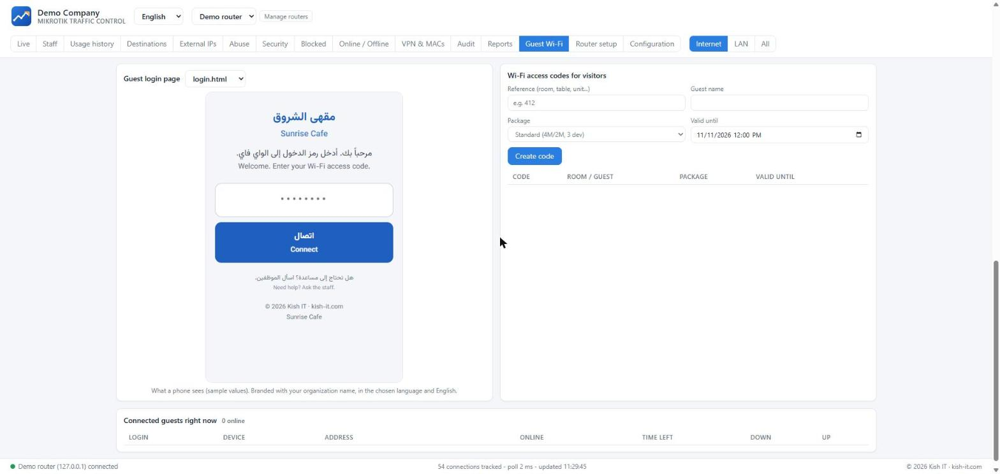

# Mikrotik Traffic Control

**اعرف من يستخدم الإنترنت. حافظ على العدالة. حافظ على الأمان.**

[English](README.md) · [فارسی](README.fa.md) · **العربية** · [Русский](README.ru.md) · [中文](README.zh.md)

## ماذا تفعل هذه الأداة؟

لكل مؤسسة تمنح الناس الإنترنت: **المكاتب والفنادق والمطاعم والمقاهي والمتاجر والمباني السكنية والمدارس والعيادات** - على راوترات MikroTik.

- 📈 **حركة مباشرة** لكل جهاز (العنوان الحقيقي للعميل حتى خلف NAT)، رسم بياني حي ثابت وقائمة أجهزة مع **إجمالي اليوم**.
- 🕒 **ساعات عملك أنت:** على مدار الساعة **24/7** (كالفنادق) أو نافذة لكل يوم من الأسبوع؛ يُحكم على استخدام الموظفين داخل هذه الساعات فقط.
- 🛡️ **الأمان:** تُجمع أحداث الأمان لكل جهاز **وتُعدّ**؛ حظر جهاز أو عنوان إنترنت بنقرة واحدة.
- ⚖️ **حصة الاستخدام:** الجهاز الذي يتجاوز حدّ التنزيل/الرفع اليومي (أو لفترة محددة) **يُبطَّأ تلقائيًا لمدة 24 ساعة**. يُحدَّد الإنترنت فقط ولا تتأثر الشبكة الداخلية.
- 🏨 **بوابة Wi-Fi للضيوف** برموز دخول وباقات سرعة وبطاقات مطبوعة؛ للفنادق والمطاعم والمباني السكنية والمكاتب.
- 🧰 **إعداد راوتر جديد:** قواعد الحظر وشبكة ضيوف معزولة وطوابير وهوت سبوت - كلها **بمعاينة ونسخة احتياطية على الراوتر** وقابلة للإزالة.
- 🌍 **5 لغات** مع تخطيط صحيح من اليمين إلى اليسار؛ غيّر اللغة من أعلى الصفحة.

## بداية سريعة (Windows)

1. نزّل **`MikrotikTrafficControl-<version>-Setup.exe`** من [صفحة الإصدارات](https://github.com/mehdimahdian/mikrotik-traffic-control/releases/latest) وشغّله.
2. يفتح دليل الإعداد في المتصفح: أدخل عنوان الراوتر وبيانات دخول المدير **مرة واحدة** (لإنشاء مستخدم API مخصص؛ لا تُحفظ).
3. اختر شبكات **الموظفين** و**الضيوف** وساعات العمل.
4. في تبويب **إعداد الراوتر** راجع القواعد والحدود ثم طبّقها.

**جرّب دون راوتر:** `npm run demo` (يتطلب Node.js بإصدار 22.5 أو أحدث).

## ملاحظات

- ساعات العمل: للفنادق اختر **«مفتوح 24/7»**؛ للمكاتب حدّد أيام الدوام وساعاته (يبدأ الأسبوع من السبت في العربية).
- الهواتف ذات «عنوان Wi-Fi خاص» تحتاج إلى عقد ثابت (static lease) ليكون الحظر موثوقًا.
- تستمع لوحة التحكم على `127.0.0.1` فقط وليس لها شاشة دخول؛ لا تنشرها على الإنترنت.
- جرّب على راوتر اختباري أولًا واحتفظ بنسخك الاحتياطية.

التوثيق الكامل (بالإنجليزية): [التثبيت](docs/INSTALL.md) · [البدء](docs/GETTING-STARTED.md) · [جهة الراوتر](docs/ROUTEROS.md) · [Wi-Fi للضيوف](docs/HOTSPOT.md) · [الترجمات](docs/I18N.md) · [المساهمة](CONTRIBUTING.md)

ترخيص MIT © Kish IT - <https://kish-it.com>

