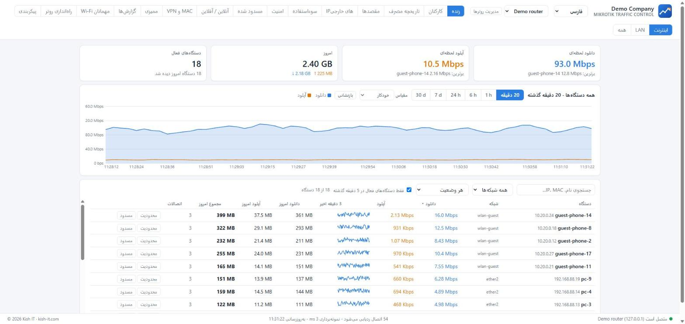

# Mikrotik Traffic Control

**ببینید چه کسی از اینترنت استفاده می‌کند. منصفانه نگه دارید. امن نگه دارید.**

[English](README.md) · **فارسی** · [العربية](README.ar.md) · [Русский](README.ru.md) · [中文](README.zh.md)

## این ابزار چه می‌کند؟

برای هر سازمانی که به افراد اینترنت می‌دهد: **اداره، هتل، رستوران و کافه، فروشگاه، ساختمان مسکونی، مدرسه، درمانگاه** - روی روترهای MikroTik.

- 📈 **ترافیک زنده** هر دستگاه (آدرس واقعی کاربر حتی پشت NAT)، نمودار زنده ثابت و فهرست دستگاه‌ها با **مجموع مصرف امروز**.
- 🕒 **ساعات کاری شما:** شبانه‌روزی **24/7** (مثل هتل) یا یک بازه برای هر روز هفته؛ مصرف غیرعادی کارکنان فقط در همین ساعات سنجیده می‌شود.
- 🛡️ **امنیت:** برای هر دستگاه همه رویدادهای امنیتی **ادغام و شمارش** می‌شود؛ مسدود کردن دستگاه یا آدرس اینترنتی با یک کلیک.
- ⚖️ **سهمیه مصرف:** دستگاهی که در روز (یا بازه دلخواه) از حد دانلود/آپلود بگذرد، **به‌طور خودکار 24 ساعت کند** می‌شود. فقط اینترنت محدود می‌شود، نه شبکه داخلی.
- 🏨 **پرتال Wi-Fi مهمان** با کد دسترسی، بسته‌های سرعت و کارت چاپی؛ برای هتل، رستوران، ساختمان مسکونی و اداره.
- 🧰 **راه‌اندازی روتر نو:** قوانین مسدودسازی، شبکه مهمان ایزوله، صف‌ها و هات‌اسپات - همه با **پیش‌نمایش، نسخه پشتیبان روی روتر** و قابل حذف.
- 🌍 **5 زبان** با چینش درست راست‌به‌چپ؛ زبان را در بالای صفحه عوض کنید.

## شروع سریع (ویندوز)

1. فایل **`MikrotikTrafficControl-<version>-Setup.exe`** را از [صفحه انتشارها](https://github.com/mehdimahdian/mikrotik-traffic-control/releases/latest) بگیرید و اجرا کنید.
2. راهنمای راه‌اندازی در مرورگر باز می‌شود: آدرس روتر و **یک‌بار** ورود مدیر را وارد کنید (برای ساخت کاربر API اختصاصی؛ ذخیره نمی‌شود).
3. شبکه‌های **کارکنان** و **مهمانان** و ساعات کاری را انتخاب کنید.
4. در تب **راه‌اندازی روتر** قوانین و محدودیت‌ها را مرور و اعمال کنید.

**بدون روتر امتحان کنید:** `npm run demo` (Node.js نسخه 22.5 یا بالاتر).

## یادداشت‌ها

- ساعات کاری: برای هتل **«باز 24/7»** را انتخاب کنید؛ برای اداره، روزهای کاری و ساعت‌ها را مشخص کنید (برای فارسی هفته از شنبه شروع می‌شود).
- گوشی‌هایی با «آدرس خصوصی Wi-Fi» برای مسدودسازی پایدار به اجاره ثابت (static lease) نیاز دارند.
- داشبورد فقط روی `127.0.0.1` گوش می‌دهد و صفحه ورود ندارد؛ آن را در اینترنت منتشر نکنید.
- ابتدا روی روتر آزمایشی امتحان کنید و نسخه پشتیبان خود را نگه دارید.

مستندات کامل (انگلیسی): [نصب](docs/INSTALL.md) · [شروع](docs/GETTING-STARTED.md) · [سمت روتر](docs/ROUTEROS.md) · [Wi-Fi مهمان](docs/HOTSPOT.md) · [ترجمه‌ها](docs/I18N.md) · [مشارکت](CONTRIBUTING.md)

مجوز MIT © Kish IT - <https://kish-it.com>

