<div align="center">


# Mikrotik Traffic Control

### See who uses your internet. Keep it fair. Keep it safe. In your language.

Live traffic · usage quotas · bandwidth control · guest Wi-Fi portal · security alerts<br>
for **MikroTik RouterOS** networks - hotels, restaurants, offices, residences, schools, clinics.

[](https://github.com/mehdimahdian/mikrotik-traffic-control/releases/latest)
[-1f9d55?style=for-the-badge)](#-try-it-in-60-seconds-no-router-needed)


[](https://github.com/mehdimahdian/mikrotik-traffic-control/actions/workflows/ci.yml)

**English** · [فارسی](README.fa.md) · [العربية](README.ar.md) · [Русский](README.ru.md) · [中文](README.zh.md)

<br>

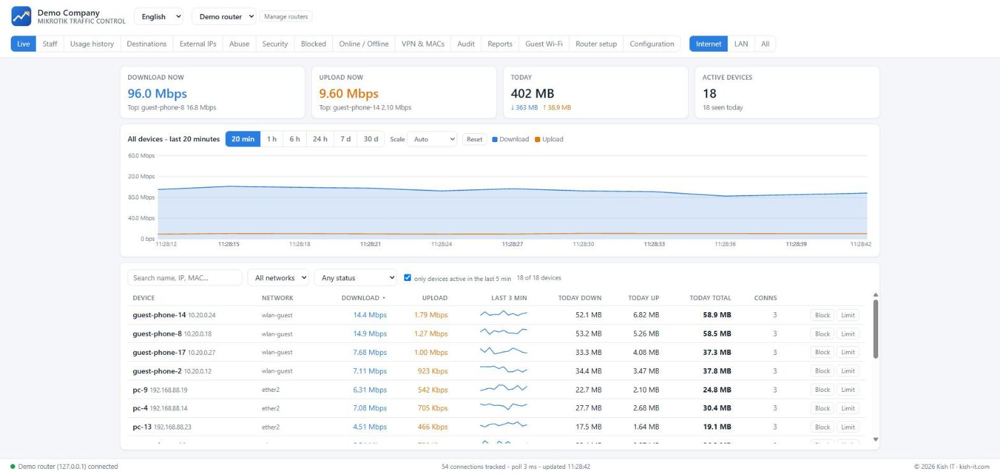

<sub>Live view (demo data): the graph stays put, the device list scrolls, every device shows today's total.</sub>

</div>

---

## 🌍 Speaks your language

> Switch the language any time in the header - no reload, and right-to-left languages are laid out properly (numbers, IP addresses and rates stay readable).

| | |
|---|---|
| 🇬🇧 **English** | Know who is using your internet - and slow down the few who use too much. |
| 🇮🇷 **فارسی** | <span dir="rtl">ببینید چه کسی از اینترنت شما استفاده می‌کند و سرعت پرمصرف‌ها را خودکار کاهش دهید.</span> |
| 🇸🇦 **العربية** | <span dir="rtl">اعرف من يستخدم إنترنتك، وأبطئ تلقائيًا من يفرط في الاستخدام.</span> |
| 🇷🇺 **Русский** | Видьте, кто пользуется интернетом, и автоматически замедляйте тех, кто злоупотребляет. |
| 🇨🇳 **中文** | 看清谁在使用您的网络，并自动限制用量过大的设备。 |

<table>
<tr>
<td width="50%">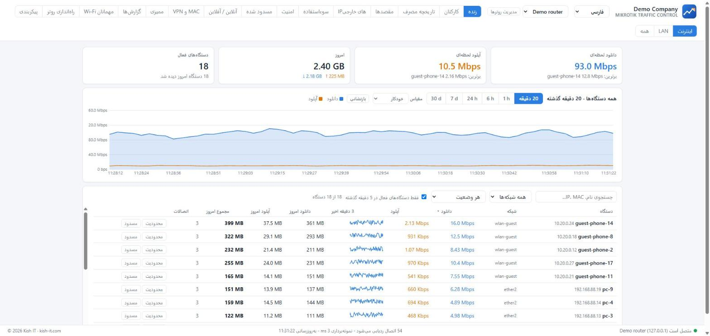<br><sub><b>فارسی</b> - fully mirrored layout, Latin numbers and units stay readable</sub></td>
<td width="50%">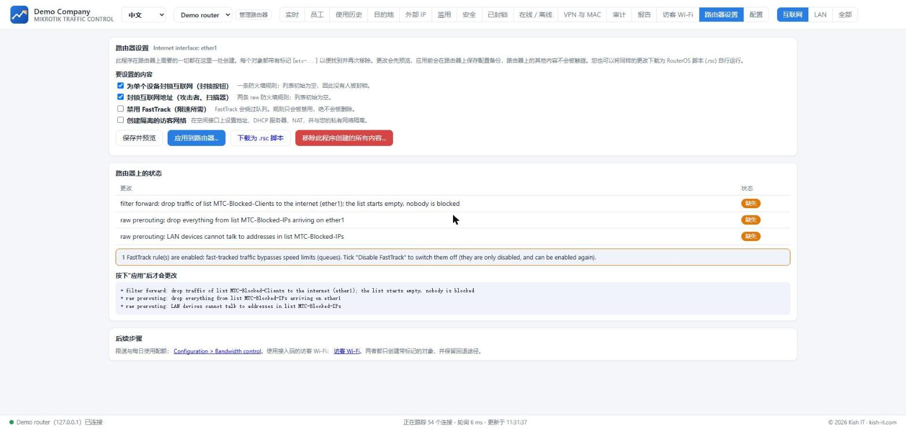<br><sub><b>中文</b> - the Router setup page</sub></td>
</tr>
<tr>
<td>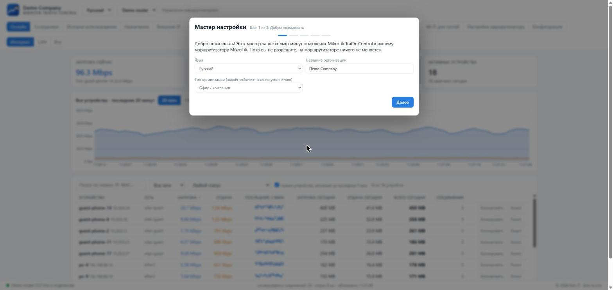<br><sub><b>Русский</b> - the first-run setup guide</sub></td>
<td>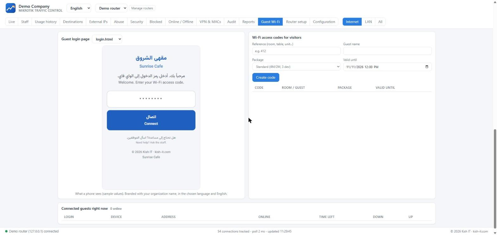<br><sub><b>العربية + English</b> - the guest Wi-Fi login page your visitors see</sub></td>
</tr>
</table>

---

## ✨ What you get

<table>
<tr>
<td width="33%" valign="top">

### 📈 See everything
Real-time rates per device (the real client even behind NAT), history for any period, destinations, outside IPs with whois, VPN and random-MAC detection, online/offline of fixed devices, printable reports in 5 languages.

</td>
<td width="33%" valign="top">

### 🛡️ Stay safe
One row **per device** with all its security events combined and counted; router traps and logs; **one-click block** of a device or an internet address; every action in an audit trail.

</td>
<td width="33%" valign="top">

### ⚖️ Keep it fair
Per-device speed by group, per-user limits, auto-throttle, and the **usage quota**: pass the daily or period download/upload limit and you are slowed for 24 hours. Internet only; the LAN is never touched.

</td>
</tr>
<tr>
<td valign="top">

### 🏨 Welcome guests
A **captive portal** with access codes, speed packages, printable cards and a walled garden - for hotels, cafes, residences, offices.

</td>
<td valign="top">

### 🕒 Your working hours
**24/7** (hotels, hospitals) or a different window for every weekday. Staff usage is judged only inside your hours.

</td>
<td valign="top">

### 🧰 Sets up a fresh router
Block rules, FastTrack handling, an isolated guest network, queues, the hotspot - **previewed, backed up on the router, removable**; also exportable as a `.rsc` script.

</td>
</tr>
</table>

### A closer look

<table>
<tr>
<td width="50%">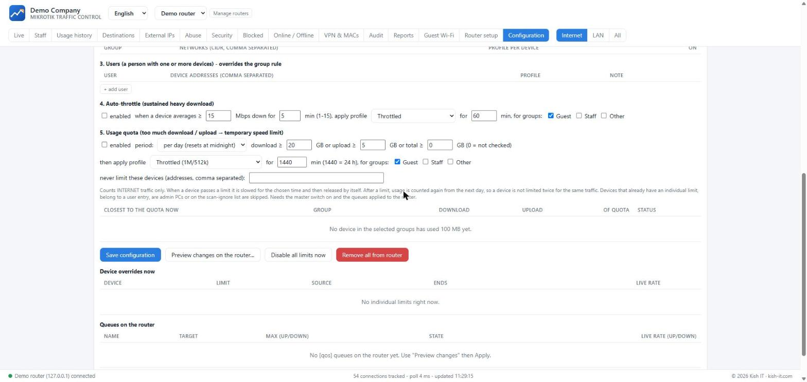<br><sub><b>Usage quota</b> and auto-throttle: slow heavy users for 24 h, automatically</sub></td>
<td width="50%">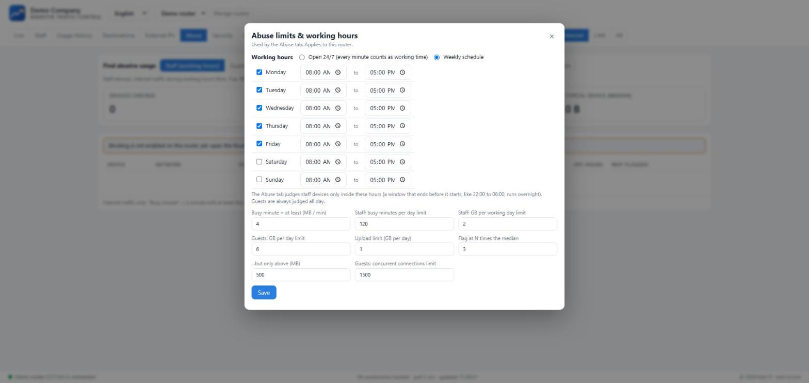<br><sub><b>Working hours</b>: 24/7 or a window per weekday</sub></td>
</tr>
<tr>
<td>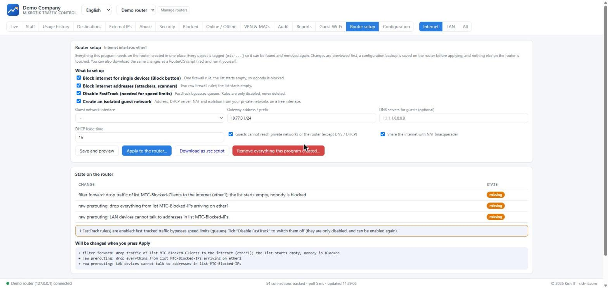<br><sub><b>Router setup</b>: preview, back up, apply, remove - or download as a .rsc script</sub></td>
<td>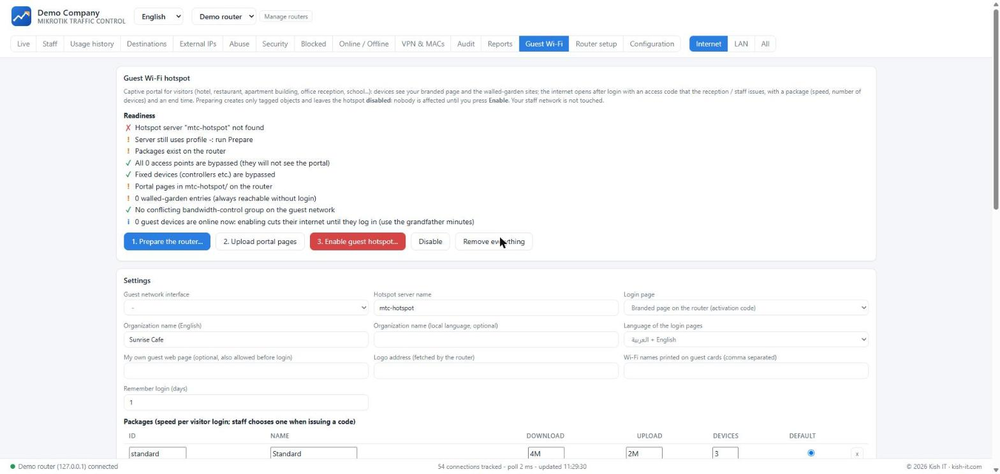<br><sub><b>Guest Wi-Fi portal</b>: readiness checks, packages, walled garden, access codes</sub></td>
</tr>
<tr>
<td colspan="2" align="center">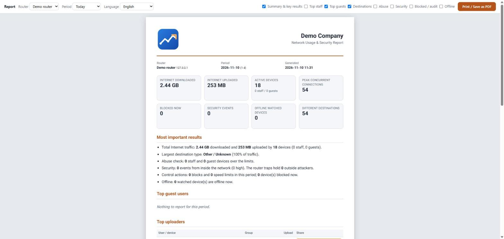<br><sub><b>Printable report</b> with your organization name and logo</sub></td>
</tr>
</table>

---

## 🚀 Get started

### ⬇ Windows installer (recommended)

1. Download **`MikrotikTrafficControl-<version>-Setup.exe`** from the **[latest release](https://github.com/mehdimahdian/mikrotik-traffic-control/releases/latest)**.
2. Run it (no administrator rights needed). The **setup guide** opens in your browser.
3. Enter the router address and an administrator login **once** - it creates a dedicated API user and is never stored.
4. Mark your networks as *staff* or *guests*, choose your working hours - done. Then open **Router setup**.

Prefer no installer? Download the **`.zip`**, unzip, double-click `windows\Install.cmd`.

### 🧪 Try it in 60 seconds (no router needed)

```bash
git clone https://github.com/mehdimahdian/mikrotik-traffic-control && cd mikrotik-traffic-control
npm run demo          # a fake MikroTik with synthetic traffic  ->  http://127.0.0.1:8787
```

### 🐧 Linux / macOS / from source

```bash
node --version        # 22.5 or newer - there is no "npm install", no dependencies
npm start             # http://127.0.0.1:8787  (this computer only)
```

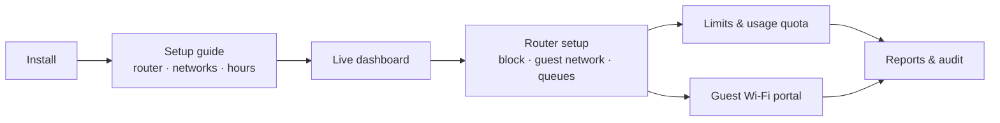

---

## 👥 Made for...

<details>
<summary><b>🏨 Hotels & guest houses</b> - 24/7 staff, guests with room codes</summary>

Mark staff PCs/Wi-Fi as *Staff* and guest Wi-Fi as *Guests*, choose **Open 24/7**. Create packages per room class, issue an access code at check-in (reference = room number, valid until check-out), print the card. Set a daily **usage quota** (for example 6 GB then 1 Mbps for 24 h) so one guest cannot take the whole line.
</details>

<details>
<summary><b>☕ Restaurants & cafes</b> - one package, codes on the receipt</summary>

Hours: every day 10:00-23:00 for POS and kitchen devices. Guest portal with one package (3 Mbps, 2 devices), codes valid for 3 hours printed on the receipt or table card, your menu in the walled garden.
</details>

<details>
<summary><b>🏢 Residential buildings & homes</b> - fair share per household</summary>

Residents' devices are *Staff* (or one network per floor), visitors are *Guests*. A per-period quota (for example 50 GB per 7 days, then slowed for 24 h) protects everyone's speed without anyone being cut off.
</details>

<details>
<summary><b>💼 Offices & shops</b> - business hours, visitor Wi-Fi</summary>

Mon-Fri 08:00-17:00 (or your week). Off-hours usage of office PCs is flagged; visitors get a short-lived code; block a compromised device from the Security tab in one click.
</details>

<details>
<summary><b>🎓 Schools, universities & clinics</b></summary>

Daytime schedule, patient/visitor Wi-Fi with a portal, throttle the heaviest downloaders, reports for management.
</details>

<details>
<summary><b>🧑‍💻 IT admins & service providers</b> - many sites, repeatable setup</summary>

Several routers in one dashboard (each with its own history and settings), least-privilege API user, everything the tool creates is tagged `mtc-` / `[mtc-...]`, previewed, backed up and removable. Export the same changes as a `.rsc` script for your own change process.
</details>

<details>
<summary><b>🛠️ Contributors</b> - zero dependencies, fake-router test suite</summary>

`npm test` runs end-to-end tests against a stateful fake RouterOS; `npm run demo` gives you a live UI to hack on. Translations are plain JSON. See [CONTRIBUTING.md](CONTRIBUTING.md) - good first issues: translations, new device classifiers, new report sections.
</details>

---

## 🔒 Safe by design

| | |
|---|---|
| **Nothing without your OK** | Every router change is previewed first, a configuration export is saved on the router, and it can be removed again. |
| **Tagged** | Everything created starts with `mtc-` / `[mtc-...]`; nothing else on the router is edited or deleted. |
| **Least privilege** | A dedicated API user (no ssh/telnet/winbox/web/reboot/password rights); your admin password is never stored. |
| **Local only** | The dashboard listens on `127.0.0.1`; router passwords are encrypted at rest (Windows DPAPI / AES-GCM). |
| **Internet only** | Speed limits apply to internet traffic; the LAN is never limited. Admin PCs can never be blocked or limited. |

More: [SECURITY.md](SECURITY.md) · [docs/ROUTEROS.md](docs/ROUTEROS.md)

---

## ❓ FAQ

<details><summary><b>Does it replace Winbox?</b></summary>No. Winbox configures the router; this tool watches usage, enforces fair-use rules, runs the guest portal and creates a handful of tagged objects for that. Everything it creates can be inspected in Winbox.</details>
<details><summary><b>Which RouterOS versions?</b></summary>6.43+ (plain API login) and 7.x; developed and tested on 7.19. It needs the API service (port 8728) reachable from the PC that runs it.</details>
<details><summary><b>Does it slow my router?</b></summary>It polls the connection table every 3 s (CPU impact is typically 1-2 %). Speed limits are normal queues. FastTrack must be off for limits to work (the tool can disable it for you, and re-enable it on removal).</details>
<details><summary><b>Can I use it on a brand-new router?</b></summary>Yes: the setup guide creates the API user, and Router setup creates the block rules, an isolated guest network (address, DHCP, NAT, isolation), queues and the hotspot.</details>
<details><summary><b>What about phones with random Wi-Fi addresses?</b></summary>Devices are tracked by IP. Give such phones a static lease (or turn off "Private Wi-Fi address" for your SSID) so blocks and limits stay reliable; the VPN &amp; MACs tab shows who rotates.</details>
<details><summary><b>Is there a login screen?</b></summary>No - it only listens on <code>127.0.0.1</code>. Reach it remotely through an SSH tunnel or remote desktop; do not publish the port. See <a href="SECURITY.md">SECURITY.md</a>.</details>
<details><summary><b>How do I add or fix a translation?</b></summary>Edit <code>src/public/i18n/&lt;lang&gt;.json</code> (plain JSON, English text is the key) and run <code>node tools/i18n-check.js</code>. See <a href="docs/I18N.md">docs/I18N.md</a>.</details>
<details><summary><b>Uninstalling?</b></summary>Remove the changes on the router from the dashboard first (Router setup → Remove everything, etc.), then uninstall; your history stays in the data folder unless you choose to delete it.</details>

---

## 📚 Documentation

| Guide | |
|---|---|
| [Install](docs/INSTALL.md) | Windows installer, zip, from source, services, data & backups |
| [Getting started](docs/GETTING-STARTED.md) | The setup guide step by step |
| [Router side](docs/ROUTEROS.md) | Everything written to the router, fresh-router setup, rollback |
| [Configuration](docs/CONFIGURATION.md) | Networks, working hours, limits, quota, security, reports |
| [Guest Wi-Fi](docs/HOTSPOT.md) | Captive portal for any business with temporary guests |
| [Use cases](docs/USE-CASES.md) | Ready-made settings per type of business |
| [Languages](docs/I18N.md) | Translations and right-to-left notes |
| [Architecture](docs/ARCHITECTURE.md) · [Troubleshooting](docs/TROUBLESHOOTING.md) · [Releasing](docs/RELEASING.md) | For maintainers and contributors |

## 🤝 Contributing

Issues and pull requests are welcome - see **[CONTRIBUTING.md](CONTRIBUTING.md)** and the [code of conduct](CODE_OF_CONDUCT.md). Translations are the easiest first contribution.

## License

[MIT](LICENSE) © Kish IT - <https://kish-it.com>. Maintained by [Mehdi Mahdian](https://github.com/mehdimahdian). "MikroTik" and "RouterOS" are trademarks of SIA Mikrotikls; this project is independent and not affiliated with or endorsed by MikroTik. Test on a lab router before production and keep your own backups.
