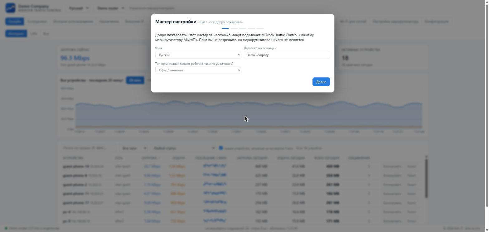

# Mikrotik Traffic Control

**Видьте, кто пользуется интернетом. Держите справедливость. Держите безопасность.**

[English](README.md) · [فارسی](README.fa.md) · [العربية](README.ar.md) · **Русский** · [中文](README.zh.md)

## Что это

Для любой организации, которая даёт людям интернет: **офисы, отели, рестораны и кафе, магазины, жилые дома, школы, клиники** - на маршрутизаторах MikroTik.

- 📈 **Живой трафик** по каждому устройству (реальный адрес клиента даже за NAT), неподвижный график и список устройств с **суточным итогом**.
- 🕒 **Ваши рабочие часы:** круглосуточно **24/7** (как в отеле) или своё окно на каждый день недели; использование сотрудников оценивается только в эти часы.
- 🛡️ **Безопасность:** все события безопасности устройства **объединяются и подсчитываются**; блокировка устройства или интернет-адреса в один клик.
- ⚖️ **Квота использования:** устройство, превысившее суточный (или за выбранный период) лимит загрузки/отдачи, **автоматически замедляется на 24 часа**. Ограничивается только интернет, локальная сеть - нет.
- 🏨 **Портал гостевого Wi-Fi** с кодами доступа, пакетами скорости и печатными карточками; для отелей, ресторанов, жилых домов и офисов.
- 🧰 **Настройка нового маршрутизатора:** правила блокировки, изолированная гостевая сеть, очереди и хотспот - всё **с предпросмотром, резервной копией на маршрутизаторе** и возможностью удаления.
- 🌍 **5 языков**, включая корректную вёрстку справа налево; язык меняется в шапке страницы.

## Быстрый старт (Windows)

1. Скачайте **`MikrotikTrafficControl-<version>-Setup.exe`** со [страницы релизов](https://github.com/mehdimahdian/mikrotik-traffic-control/releases/latest) и запустите.
2. В браузере откроется мастер: введите адрес маршрутизатора и логин администратора **один раз** (для создания отдельного пользователя API; не сохраняется).
3. Отметьте сети **сотрудников** и **гостей**, выберите рабочие часы.
4. На вкладке **Настройка маршрутизатора** просмотрите и примените правила и лимиты.

**Попробовать без маршрутизатора:** `npm run demo` (нужен Node.js 22.5 или новее).

## Заметки

- Рабочие часы: для отеля выберите **«Открыто 24/7»**; для офиса укажите рабочие дни и часы.
- Телефонам с «частным адресом Wi-Fi» нужна постоянная аренда (static lease), чтобы блокировка работала надёжно.
- Панель слушает только `127.0.0.1` и не имеет экрана входа; не публикуйте её в интернете.
- Сначала проверьте на тестовом маршрутизаторе и храните свои резервные копии.

Документация (на английском): [Установка](docs/INSTALL.md) · [Начало](docs/GETTING-STARTED.md) · [Маршрутизатор](docs/ROUTEROS.md) · [Гостевой Wi-Fi](docs/HOTSPOT.md) · [Переводы](docs/I18N.md) · [Участие](CONTRIBUTING.md)

Лицензия MIT © Kish IT - <https://kish-it.com>
