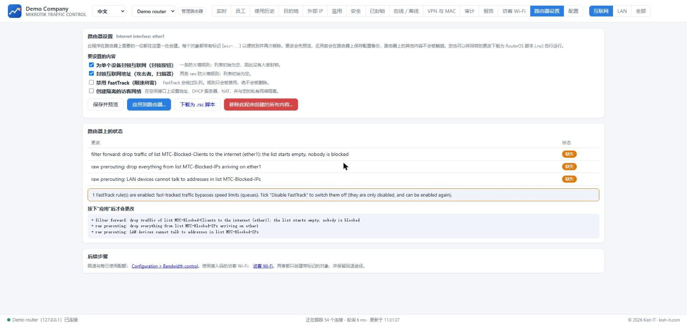

# Mikrotik Traffic Control

**看清谁在上网。保持公平。保持安全。**

[English](README.md) · [فارسی](README.fa.md) · [العربية](README.ar.md) · [Русский](README.ru.md) · **中文**

## 这是什么

面向任何为人们提供上网服务的机构：**办公室、酒店、餐厅和咖啡馆、商店、住宅楼、学校、诊所** - 基于 MikroTik 路由器。

- 📈 **实时流量**：按设备显示（即使在 NAT 之后也能看到真实客户端地址），固定的实时图表，设备列表显示**今日总用量**。
- 🕒 **您自己的工作时间**：**24/7** 全天候（如酒店）或为每个工作日设置时间段；员工用量只在这些时间内评判。
- 🛡️ **安全**：每台设备的所有安全事件**合并并计数**；一键封锁设备或互联网地址。
- ⚖️ **使用配额**：设备在一天（或指定周期）内超过下载/上传限额，将**自动限速 24 小时**。只限制互联网，不影响内部网络。
- 🏨 **访客 Wi-Fi 门户**：接入码、速度套餐和可打印卡片；适用于酒店、餐厅、住宅楼和办公室。
- 🧰 **全新路由器设置**：封锁规则、隔离的访客网络、队列和热点 - 全部**先预览、先在路由器上备份**，并可移除。
- 🌍 **5 种语言**，正确支持从右到左排版；在页面顶部切换语言。

## 快速开始（Windows）

1. 从[发布页面](https://github.com/mehdimahdian/mikrotik-traffic-control/releases/latest)下载 **`MikrotikTrafficControl-<version>-Setup.exe`** 并运行。
2. 浏览器会打开设置向导：输入路由器地址和**一次**管理员登录（用于创建专用 API 用户，不会被保存）。
3. 标记**员工**网络和**访客**网络，选择工作时间。
4. 在 **路由器设置** 标签页查看并应用规则与限速。

**无需路由器即可试用：** `npm run demo`（需要 Node.js 22.5 或更高版本）。

## 说明

- 工作时间：酒店请选择**“全天候 24/7”**；办公室请设置工作日和时间。
- 开启“私有 Wi-Fi 地址”的手机需要固定租约（static lease），封锁才可靠。
- 控制台只监听 `127.0.0.1` 且没有登录界面，请勿暴露到互联网。
- 请先在测试路由器上试用，并保留自己的备份。

文档（英文）：[安装](docs/INSTALL.md) · [入门](docs/GETTING-STARTED.md) · [路由器端](docs/ROUTEROS.md) · [访客 Wi-Fi](docs/HOTSPOT.md) · [翻译](docs/I18N.md) · [贡献](CONTRIBUTING.md)

MIT 许可证 © Kish IT - <https://kish-it.com>
